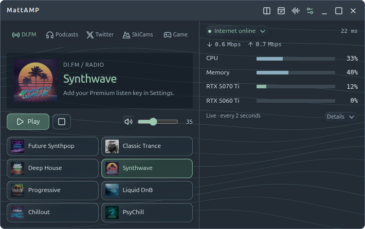
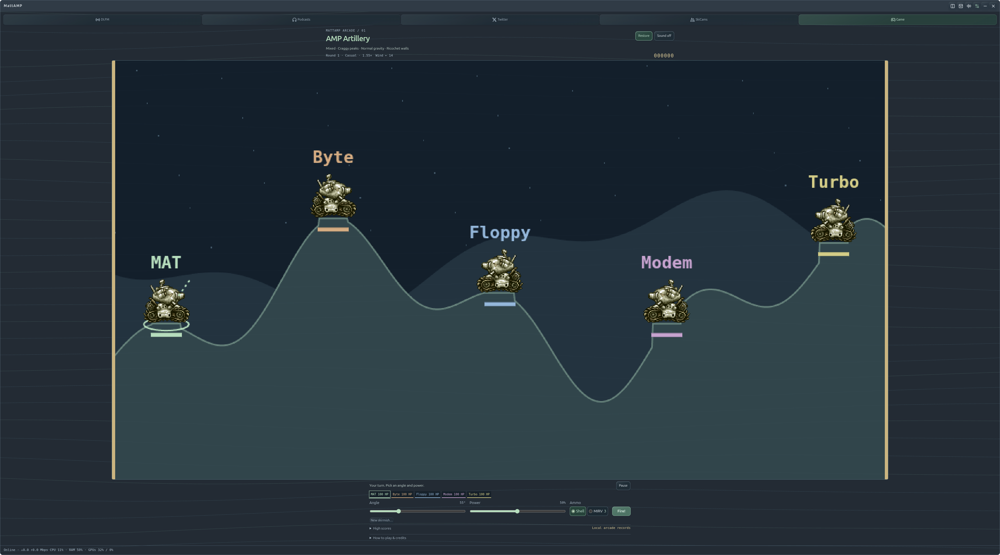
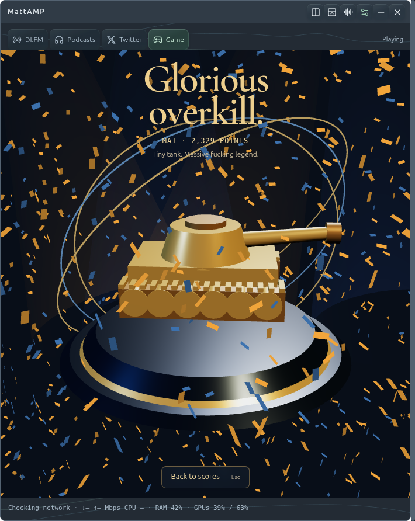

<p align="center">
  
</p>

# MattAMP

**Reclaim your desktop. Lose an evening.**

Remember when your computer had a personality? Winamp was playing, Fractint was doing something hypnotic, and “one more round” of Scorched Earth was a perfectly reasonable use of the next three hours?

MattAMP started with a much smaller ambition: replace a few desktop widgets and get some screen space back. Then came the radio presets. The podcasts. The glass buttons. The drifting fractals. Then somebody said “MIRVs,” and here we are.

It's a small, slightly ridiculous Linux desktop app: **music, podcasts, a filtered X feed, system stats, and an artillery game with bots that hold grudges.** It even does the llama intro.

[Get running](#get-running) · [Play artillery](#tiny-tanks-questionable-decisions) · [Music & podcasts](#something-good-in-your-ears) · [Controls](#make-yourself-at-home) · [Troubleshooting](docs/guide.md#troubleshooting) · [Development](docs/development.md)



## What's in the little box?

| The useful stuff | The entirely reasonable additions |
| --- | --- |
| Eight DI.FM presets with official channel art | Scorched Earth–inspired tank battles and MIRVs |
| Your podcast lineup: YouTube episodes or audio | Sarcastic bots with three-match grudges |
| A filtered X/Twitter pane and customizable SkiCams | Ricochet walls, wraparound shots, and occasional absurd wind |
| Live CPU, memory, network, and NVIDIA GPU meters | Mouse-reactive particles, waves, stars, and Mandelbrot glides |
| Stacked, sidecar, compact, and tiny bug layouts | A wildly unnecessary 3D victory ceremony |

Built for a Linux workstation and a large OLED, with dark glass, muted color, and enough contrast to find the window. The effects are optional. The silliness is more fundamental.

## Get running

### Just let me play

**[Download the Linux x64 runtime ZIP](https://drive.google.com/file/d/1c_W4ALm0PoKuRQJ8SB-4nG0fc_SfvX7J/view)** — shared build `cb2d469`.

1. Extract the **whole folder** somewhere permanent, such as `~/Apps/MattAMP`.
2. Open a terminal in the extracted `MattAMP` folder and run:

   ```sh
   ./MattAMP
   ```

3. Click **Game**, choose your bots and difficulty, and hit **Start battle**. Chaos starts on **Mixed**.

The runtime ZIP includes Electron and its dependencies. **No Node.js, npm, account, subscription, or internet connection is needed to play artillery.** This download is a fixed build, not an auto-updating installer; the source instructions below get the current code.

Want it in your application menu and dock? From the same folder:

```sh
bash scripts/install.sh
```

Launch **MattAMP** from the application menu, then pin it using your desktop's usual controls. Keep the extracted folder in place: the launcher points to it.

**Requirements:** 64-bit Intel/AMD Linux, a graphical desktop, and the usual Electron desktop libraries. NVIDIA hardware is optional. The shared bundle is not an ARM, Windows, or macOS build; compatibility has not been tested on every Linux distribution.

<details>
<summary>Ubuntu sandbox error, or want to verify the download?</summary>

If Ubuntu reports a user-namespace or SUID sandbox-helper error, run this from the extracted folder and approve the administrator prompt:

```sh
bash scripts/install-sandbox-profile.sh
```

It installs an AppArmor profile for this folder's Electron executable. Run it again if you move the folder. Launch MattAMP as your normal user; keep Electron's sandbox enabled.

SHA-256 for `MattAMP-linux-x64-cb2d469.zip`:

```text
7e0a1cf4719cfa88e4fc91f2a255de70c0cef817281c5c0239134e9a3d8fbb58
```

Compare with `sha256sum MattAMP-linux-x64-cb2d469.zip` before extracting. More help: [troubleshooting](docs/guide.md#troubleshooting).

</details>

### Run the current source

The repository is public. With Git, Node.js, and npm installed:

```sh
git clone https://github.com/matt-dreyer/MattAMP.git
cd MattAMP
npm ci
./MattAMP
```

A GitHub **Download ZIP** contains source only; it still needs `npm ci`. The runtime download above already includes what it needs. See the [development guide](docs/development.md) for checks, packaging, and project layout.

## Tiny tanks. Questionable decisions.

**AMP Artillery** is an untimed, last-tank-standing skirmish against **3–5 bots**. Pick a skill from **Very dumb** to **Human-ish**, enter your three-letter arcade initials, and start rearranging the landscape.



You get unlimited shells and **three MIRVs**, each splitting into five warheads. Terrain deforms, splash damage hurts, falling hurts, and wind occasionally decides that your carefully calculated shot belongs in another postcode.

The bots have opinions. They can return fire, remember who hurt them across three completed battles, and gang up on a repeat winner—including another bot. Good hits and spectacular misses earn sarcastic, sometimes profane cartoon heckles.

### The controls

| Do this | With this |
| --- | --- |
| Aim left / right | **← / →**, the Angle slider, or click the sky |
| Increase / decrease power | **↑ / ↓** or the Power slider |
| Adjust precisely with the wheel | Hover **Angle** or **Power**; wheel over the battlefield changes power |
| Choose ammunition | **Shell / MIRV** buttons |
| Fire | **Enter** or **Fire!** |
| Make room for destruction | **Expand**, then resize the window |
| Return to the widget | **Restore** or **Esc** |
| Play another match | Click the finished battlefield; keyboard users can focus it and press **Enter / Space** |

### Choose your chaos

| Mode | What the next arena throws at you |
| --- | --- |
| **Off** | Rolling hills, normal gravity, open sides. Wind still varies. |
| **Mixed — default** | One of five terrains, plus altered gravity **or** special walls. |
| **Unhinged** | Varied terrain, altered gravity **and** special walls. |

Moonshot gravity floats your shots. Heavy gravity brings them home early. Ricochet walls bounce them back; wraparound walls send them through the other side. The preview shows the actual arena you'll play. Wind changes each turn; terrain style, gravity, and wall rules stay fixed for that match.

**Top ten scores and lifetime wins save locally.** There is no turn timer. Radio or an audio podcast can keep playing. Leaving the game pauses the battle.

<details>
<summary>And if you win? We may have overdone it.</summary>



Nine seconds of a GPU-rendered gold tank, moving camera, lights, 2,400 pieces of confetti, and a fanfare. An entirely proportionate response to defeating Floppy.

**Back to scores** or **Esc** skips it. Reduced motion gives you a still scene; a WebGL failure falls back to a static victory message. Your score saves independently of the spectacle.

</details>

[Game rules, scoring, wind, and rivalries →](docs/artillery.md)

## Something good in your ears

### DI.FM

**Future Synthpop · Classic Trance · Deep House · Synthwave · Progressive · Liquid DnB · Chillout · PsyChill**

Bring your own **DI.FM Premium subscription with external-player access**. Open MattAMP's **Settings → DI.FM settings**, find your Premium listen key, paste only the key into MattAMP, save, and choose a station. Covers load from DI.FM's provider catalog.

The key is encrypted when a protected system keyring is available. Otherwise it stays in memory for that session; MattAMP does not save a plaintext fallback.

### Podcasts

**Last Week in AI · AI for Humans · All-In · Dwarkesh Podcast · The a16z Show**

Choose **YouTube** for full video episodes or **Audio feed** for RSS audio. The YouTube selection filters out Shorts and clips, and starts at **1×** unless you've saved another speed. Audio gets seek, skip, speed, and resume controls. Only one radio/podcast source plays at a time.

Radio and audio can follow you into the game, X, or tiny bug mode. **YouTube pauses when its player is hidden.** Some uploads block embedding; the external **YouTube** button and **Audio feed** are your alternatives.

## A little signal from X

**AI circle** filters X's Latest search to Boris Cherny, Peter Steinberger, Andrej Karpathy, Simon Willison, and Chamath, with AI-topic filtering. **For giggles** gives Elon his own lane. **Filters** lets you change the handles and topic restriction.

Sign in on X's own page inside the app. The session stays in MattAMP. **Browser** opens the same search using your normal browser's login; Google/Apple sign-in stays there and does **not** sign in the embedded pane. See [X sign-in and limitations](docs/guide.md#xtwitter).

## Make yourself at home

| Control | What happens |
| --- | --- |
| Layout button | Switch between sidecar and stacked layouts |
| Compact button | Trim the player down |
| Bug button | Collapse to a draggable **56 × 56** logo; click it to restore |
| Settings | Radio setup, live background, and other preferences |
| Minimize **−** | Hide to the tray |
| Close **×** | Quit MattAMP |
| **Details** under the meters | Show memory, VRAM, and GPU temperatures |

**Live backgrounds:** Particle flow, Water waves, Starfield, Mandelbrot zoom, or Off. They react gently to the mouse. Mandelbrot wanders through different regions with glides, curves, and spirals—a little Fractint affection, without turning the room into a flashlight. Animation pauses when hidden or in bug mode and respects reduced motion.

CPU, memory, and network readings update every two seconds. NVIDIA GPU readings use `nvidia-smi`; absent sensors show as unavailable. Expand network status for router/internet checks.

## The practical bits

- **Local data:** settings, playback positions, X sessions, and arcade scores stay under `~/.config/workstation-deck/`. The old internal name preserves existing installs. [Storage and privacy](docs/guide.md#local-data-and-privacy)
- **Updates:** manual. There is no auto-updater or automatic launch at login. [Update and uninstall](docs/development.md#updating-and-uninstalling)
- **Trouble:** [launch errors, radio, YouTube feeds, X login, and missing meters](docs/guide.md#troubleshooting).
- **Credits:** Winamp and Fractint supplied the nostalgia; Scorched Earth inspired the artillery. Bundled retro artwork and audio retain their original copyrights. This repo does **not** grant a blanket license to redistribute them. See [asset credits](assets/arcade/README.md) and [startup audio provenance](docs/guide.md#startup-audio-and-credits).

A fun personal app that escaped the desktop. Bring headphones. Blame the wind.
