<p align="center">
  
</p>

# MattAMP

**Reclaim your desktop. Lose an evening.**

Remember when your computer had a personality? Winamp was playing, Fractint was doing something hypnotic, and “one more round” of Scorched Earth was a perfectly reasonable use of the next three hours?

MattAMP started with a much smaller ambition: replace a few desktop widgets and get some screen space back. Then came the radio presets. The podcasts. The glass buttons. The drifting fractals. Then came mountain webcams—because checking the snow is also a desktop essential. Then somebody said “MIRVs,” and here we are.

It's a small, slightly ridiculous desktop app for Linux, Windows, and macOS: **music, podcasts, SkiCams, a filtered X feed, system stats, and an artillery game with bots that hold grudges.** It even does the llama intro.

[Screenshots](#take-a-look-around) · [Get running](#get-running) · [SkiCams](#skicams-send-it) · [Play artillery](#tiny-tanks-questionable-decisions) · [Music & podcasts](#something-good-in-your-ears) · [Controls](#make-yourself-at-home) · [Troubleshooting](docs/guide.md#troubleshooting) · [Development](docs/development.md)


## What's in the little box?

| The useful stuff | The entirely reasonable additions |
| --- | --- |
| Eight DI.FM presets with official channel art | Scorched Earth–inspired tank battles and MIRVs |
| Your podcast lineup: YouTube episodes or audio | Sarcastic bots with three-match grudges |
| SkiCams with your own favorites and automatic rotation | Optional “Send it!” and other silly tab greetings |
| A filtered X/Twitter pane | Ricochet walls, wraparound shots, and occasional absurd wind |
| Live CPU, memory, network, and NVIDIA GPU meters | Mouse-reactive particles, waves, stars, and Mandelbrot glides |
| Stacked, sidecar, compact, and tiny bug layouts | A wildly unnecessary 3D victory ceremony |

Built for a Linux workstation and a large OLED, with dark glass, muted color, and enough contrast to find the window. The effects are optional. The silliness is more fundamental.

## Take a look around

Every tab, every size, and every background. These are captures of the running app using a fresh profile; Twitter shows its signed-out screen. Click any image for the full-size view. Animated backgrounds are frozen mid-frame here.

<details>
<summary>All five tabs — including both podcast players</summary>

| DI.FM radio | Podcasts · YouTube |
| --- | --- |
|  | 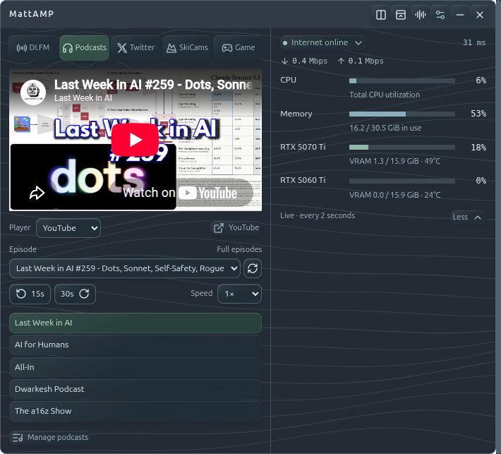 |
| **Podcasts · Audio feed** | **Twitter · signed out** |
| 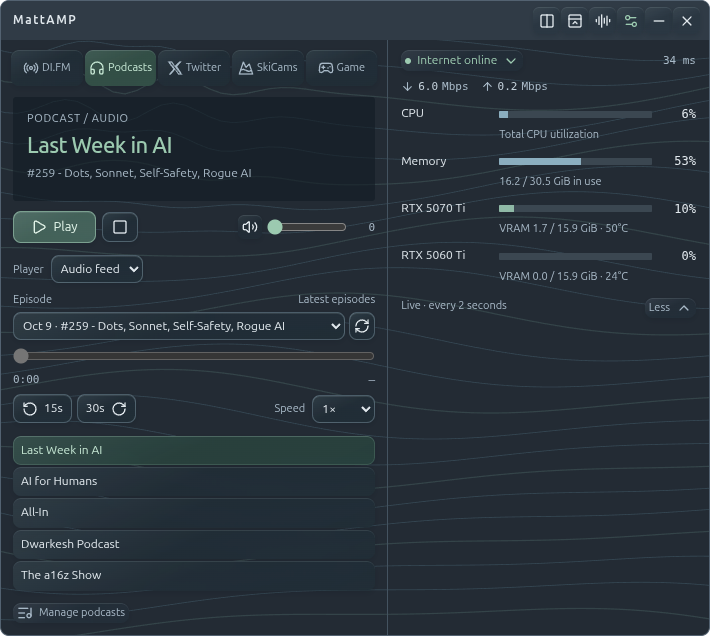 | 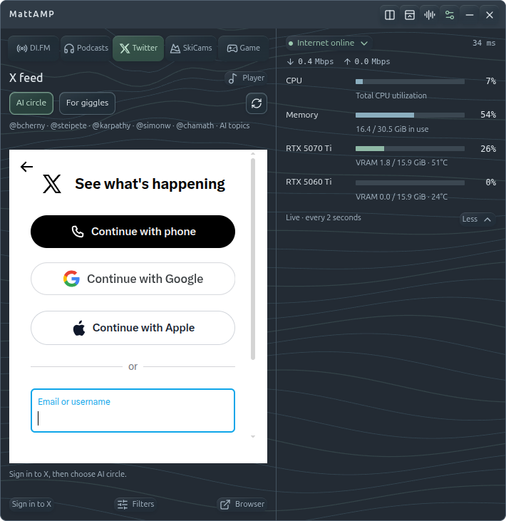 |
| **SkiCams** | **Game · widget size** |
| 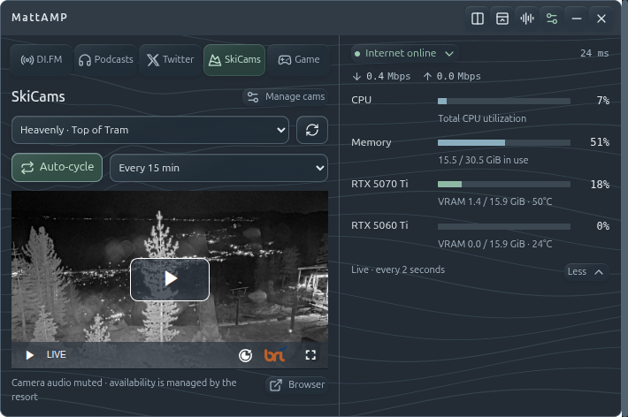 | 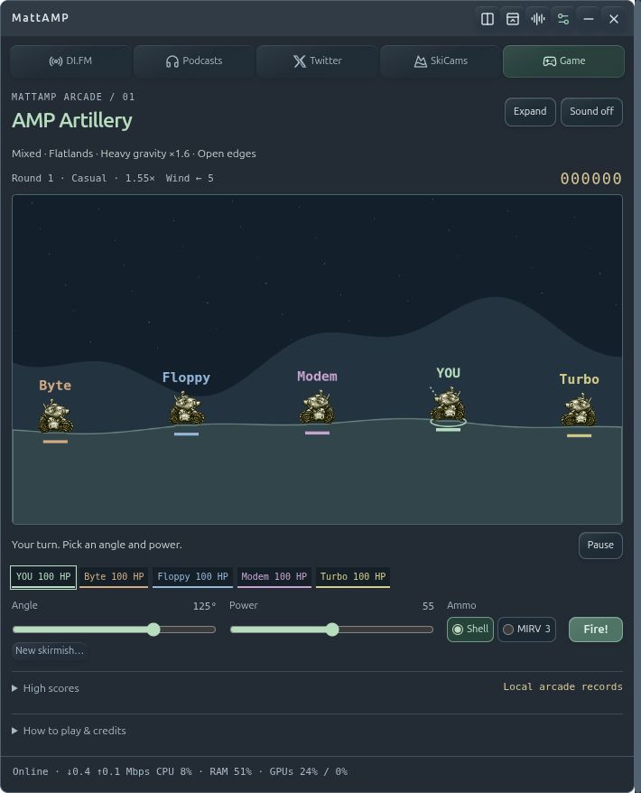 |

</details>

<details>
<summary>Four desktop layouts, plus the expanded battlefield</summary>

| Sidecar · meters alongside | Stacked · meters below |
| --- | --- |
|  | 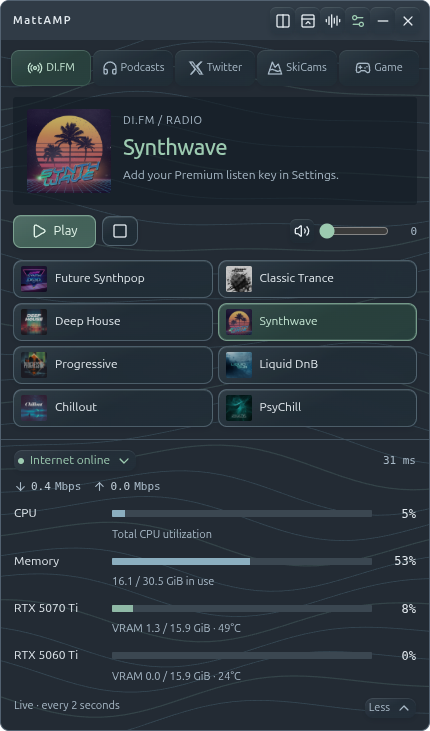 |
| **Compact · player and a status strip** | **Bug · actual 56 × 56 size** |
| 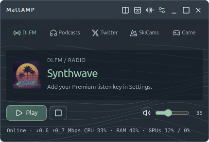 |  |

**Expanded Game** keeps the controls together while giving the battlefield more room:


</details>

<details>
<summary>Backgrounds — particles, waves, stars, fractals, or none</summary>

| Particle flow | Water waves |
| --- | --- |
| 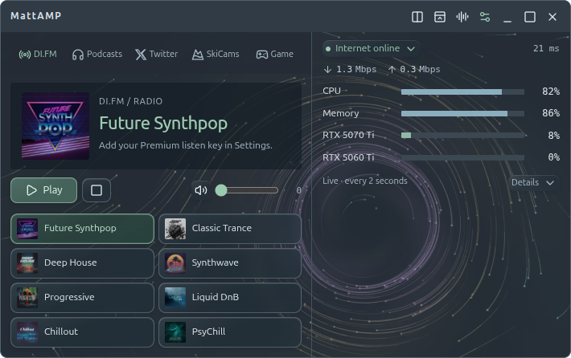 |  |
| **Starfield** | **Mandelbrot zoom** |
|  | 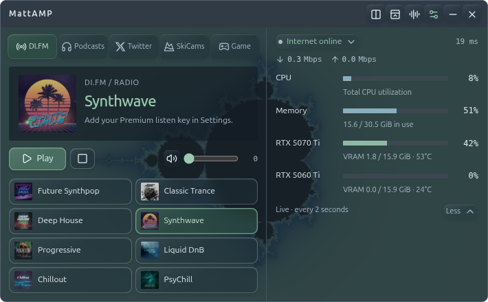 |

**Off**, when you'd rather sit still:

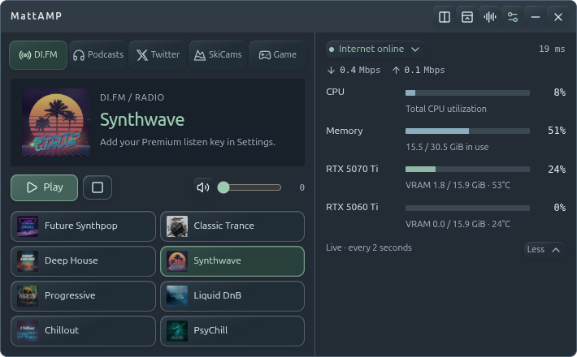

</details>

<details>
<summary>Make it yours — podcast and camera favorites</summary>

**Your podcasts:** add YouTube or RSS links, edit favorites, and put them in your order.

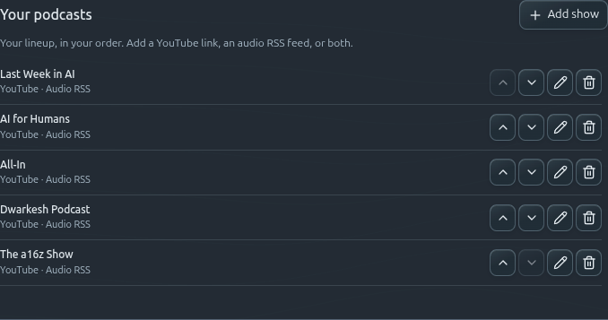

**Your SkiCams:** build your own mountain lineup.

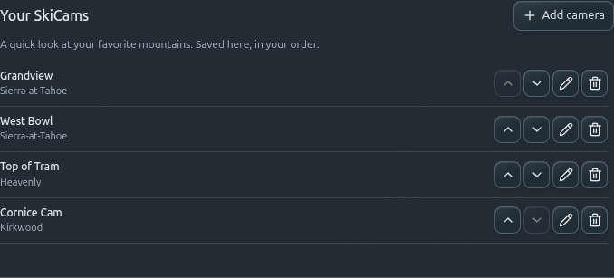

</details>

## Get running

### Install a packaged release

Get the current installers and portable apps from **[GitHub Releases](https://github.com/matt-dreyer/MattAMP/releases/latest)**. No Node.js or npm required.

| Your machine | Download |
| --- | --- |
| Ubuntu/Debian x64 | `.deb` installer; includes sandbox integration |
| Other Linux x64 | `.AppImage` or portable `.tar.gz` |
| Windows x64 | `windows-x64-setup.exe` or portable `win-x64.zip` |
| Apple Silicon Mac | `mac-arm64.dmg` or `.zip` |
| Intel Mac | `mac-x64.dmg` or `.zip` |

Windows packages are unsigned; Mac packages are ad-hoc signed and not notarized. See the [release notes](docs/release-0.3.0.md) for first-launch instructions and platform limitations. Check downloads against the release's `SHA256SUMS.txt`.

<details>
<summary>Earlier Linux bundle (before SkiCams)</summary>

This older build predates SkiCams and configurable favorites. Use **GitHub Releases above** for the current packaged app.

**[Download the Linux x64 runtime ZIP](https://drive.google.com/file/d/1c_W4ALm0PoKuRQJ8SB-4nG0fc_SfvX7J/view)** — shared build `cb2d469`.

1. Extract the **whole folder** somewhere permanent, such as `~/Apps/MattAMP`.
2. Open a terminal in the extracted `MattAMP` folder and run:

   ```sh
   ./MattAMP
   ```

3. Click **Game**, choose your bots and difficulty, and hit **Start battle**. Chaos starts on **Mixed**.

The runtime ZIP includes Electron and its dependencies. **No Node.js, npm, account, subscription, or internet connection is needed to play artillery.** This download is a fixed build, not an auto-updating installer; the source instructions below get the current code.

Want it in your application menu and dock? From the same folder:

```sh
bash scripts/install.sh
```

Launch **MattAMP** from the application menu, then pin it using your desktop's usual controls. Keep the extracted folder in place: the launcher points to it.

**Requirements:** 64-bit Intel/AMD Linux, a graphical desktop, and the usual Electron desktop libraries. NVIDIA hardware is optional. The shared bundle is not an ARM, Windows, or macOS build; compatibility has not been tested on every Linux distribution.

<details>
<summary>Ubuntu sandbox error, or want to verify the download?</summary>

If Ubuntu reports a user-namespace or SUID sandbox-helper error, run this from the extracted folder and approve the administrator prompt:

```sh
bash scripts/install-sandbox-profile.sh
```

It installs an AppArmor profile for this folder's Electron executable. Run it again if you move the folder. Launch MattAMP as your normal user; keep Electron's sandbox enabled.

SHA-256 for `MattAMP-linux-x64-cb2d469.zip`:

```text
7e0a1cf4719cfa88e4fc91f2a255de70c0cef817281c5c0239134e9a3d8fbb58
```

Compare with `sha256sum MattAMP-linux-x64-cb2d469.zip` before extracting. More help: [troubleshooting](docs/guide.md#troubleshooting).

</details>

</details>

### Run the current source

The repository is public. With Git, Node.js, and npm installed:

```sh
git clone https://github.com/matt-dreyer/MattAMP.git
cd MattAMP
npm ci
npm start
```

A GitHub **Download ZIP** contains source only; it still needs `npm ci`. The runtime download above already includes what it needs. See the [development guide](docs/development.md) for checks, packaging, and project layout.

## SkiCams. Send it.

A little window onto the mountain while your music keeps playing. Check the summit, watch the weather move in, or leave your favorite views rotating beside your work. The **SkiCams** tab lives right before **Game**—conditions first, questionable decisions second.


The starting lineup:

| Resort | Cameras |
| --- | --- |
| Sierra-at-Tahoe | Grandview · West Bowl |
| Heavenly | Top of Tram |
| Kirkwood | Cornice Cam |

**Make it your mountains:** choose **Manage cams** (or **Settings → Your SkiCams**), then **Add camera**. Give it a name, optionally a resort, and paste a public HTTPS camera link. YouTube live links and direct camera players fit best; resort pages work too, with their own navigation. Edit, reorder, or remove favorites, with undo for removals.

**Let it roam:** turn on **Auto-cycle** and choose **1, 5, 15, 30, or 60 minutes**. It starts off, with 15 minutes selected. Rotation follows your saved order while SkiCams is visible, pauses when you leave, and restarts the interval when you choose a camera manually.

Cameras stay muted so DI.FM or an audio podcast can keep playing. Hidden YouTube podcasts pause. Streams, weather, daylight, and uptime belong to the resort; **Refresh** reconnects, and **Browser** opens the provider page if an embed won't cooperate.

<details>
<summary>Your camera lineup, in Settings</summary>


Your favorites and rotation preferences stay on your machine. No MattAMP account or API key is needed for the included public cameras.

</details>

## Tiny tanks. Questionable decisions.

**AMP Artillery** is an untimed, last-tank-standing skirmish against **3–5 bots**. Pick a skill from **Very dumb** to **Human-ish**, enter your three-letter arcade initials, and start rearranging the landscape. Your initials also name your tank on the battlefield and health roster.


Power now uses a gentler **1–100%** scale, starting at **50%**, so close shots have room on the dial. Bot shots briefly show the shooter’s angle and power; toggle this in **Settings → Game**.

You get unlimited shells and **three MIRVs**, each splitting into five warheads. Terrain deforms, splash damage hurts, falling hurts, and wind occasionally decides that your carefully calculated shot belongs in another postcode.

**New in v0.3.0:** getting knocked out puts you in spectator mode. The bots finish their fight on-screen, and the survivor does a dumb little victory dance—occasionally a wheelie. Scores and grudges use the actual final result.

The bots have opinions. They can return fire, remember who hurt them across three completed battles, and gang up on a repeat winner—including another bot. Good hits and spectacular misses earn dry, sarcastic cartoon heckles.

### The controls

| Do this | With this |
| --- | --- |
| Start a battle | Click the preview battlefield or **Start battle** |
| Aim left / right | **← / →**, the Angle slider, or click the sky |
| Increase / decrease power | **↑ / ↓** or the Power slider |
| Adjust precisely with the wheel | Hover **Angle** or **Power**; wheel over the battlefield changes power |
| Choose ammunition | **Shell / MIRV** buttons |
| Fire | **Enter** or **Fire!** |
| Make room for destruction | **Expand**, then resize; your size stays through new battles until you change tabs |
| Fill the screen | Title-bar **Maximize** beside minimize; click it again to restore your previous size |
| Return from expanded play | **Restore** or **Esc** |
| Play another match | Click the finished battlefield; keyboard users can focus it and press **Enter / Space** |

### Choose your chaos

| Mode | What the next arena throws at you |
| --- | --- |
| **Off** | Rolling hills, normal gravity, open sides. Wind stays fixed for the entire battle. |
| **Mixed — default** | One of five terrains, plus altered gravity **or** special walls. |
| **Unhinged** | Varied terrain, altered gravity **and** special walls. |

Moonshot gravity floats your shots. Heavy gravity brings them home early. Ricochet walls bounce them back; wraparound walls send them through the other side. Each terrain type rolls fresh heights, widths, slopes, and asymmetry; even normal rolling hills get a new silhouette. Tank pads blend into the landscape. The preview shows the actual arena you'll play. With Chaos Off, wind is rolled once for the battle; Mixed and Unhinged change it each turn. Terrain style, gravity, and wall rules stay fixed for that match.

**Humans and bots share a local top-ten leaderboard**, using the same scoring rules. Bots are marked by name; your lifetime wins stay separate. Existing human scores remain, and bot entries begin with newly completed battles. There is no turn timer. Radio or an audio podcast can keep playing. Leaving the game pauses the battle.

<details>
<summary>And if you win? We may have overdone it.</summary>


Nine seconds of a GPU-rendered gold tank, moving camera, lights, 2,400 pieces of confetti, and a fanfare. An entirely proportionate response to defeating Floppy.

**Back to scores** or **Esc** skips it. Reduced motion gives you a still scene; a WebGL failure falls back to a static victory message. Your score saves independently of the spectacle.

</details>

[Game rules, scoring, wind, and rivalries →](docs/artillery.md)

## Something good in your ears

### DI.FM

**Future Synthpop · Classic Trance · Deep House · Synthwave · Progressive · Liquid DnB · Chillout · PsyChill**

Bring your own **DI.FM Premium subscription with external-player access**. Open MattAMP's **Settings → DI.FM settings**, find your Premium listen key, paste only the key into MattAMP, save, and choose a station. Covers load from DI.FM's provider catalog.

The key is encrypted when a protected system keyring is available. Otherwise it stays in memory for that session; MattAMP does not save a plaintext fallback.

### Podcasts

**Last Week in AI · AI for Humans · All-In · Dwarkesh Podcast · The a16z Show**

Those are the starting favorites. In **Settings → Your podcasts**, add your own YouTube channel/playlist or RSS feed links, then edit, reorder, or remove shows. A full-episode playlist gives the most control over what appears.

Choose **YouTube** for full video episodes or **Audio feed** for RSS audio. The YouTube selection filters out Shorts and clips, and starts at **1×** unless you've saved another speed. Audio gets seek, skip, speed, and resume controls. Only one radio/podcast source plays at a time.

Radio and audio can follow you into SkiCams, the game, X, or tiny bug mode. **YouTube pauses when its player is hidden.** Some uploads block embedding; the external **YouTube** button and **Audio feed** are your alternatives.

## A little signal from X

**AI circle** filters X's Latest search to Boris Cherny, Peter Steinberger, Andrej Karpathy, Simon Willison, and Chamath, with AI-topic filtering. **For giggles** gives Elon his own lane. **Filters** lets you change the handles and topic restriction.

Sign in on X's own page inside the app. The session stays in MattAMP. **Browser** opens the same search using your normal browser's login; Google/Apple sign-in stays there and does **not** sign in the embedded pane. See [X sign-in and limitations](docs/guide.md#xtwitter).

## Make yourself at home

**A lighter navigation bar:** DI.FM, Podcasts, Twitter, SkiCams, and Game are icons and text, with a soft hover highlight and mint for the active tab. The strip is 70% opaque with a subtle blur, so the live background can show through. It stays pinned as you scroll, along with the bare title-bar icons. Keyboard focus rings and full click targets remain.

This navigation refresh and the Retro skin below are in current source builds; the published v0.3.0 installers have the earlier styling.

| Control | What happens |
| --- | --- |
| Layout button | Switch between sidecar and stacked layouts |
| Compact button | Trim the player down |
| Bug button | Collapse to a draggable **56 × 56** logo; click it to restore |
| Maximize / Restore | Fill the screen, then return to your previous size |
| Settings | Your podcasts, SkiCams, radio setup, live background, and other preferences |
| Minimize **−** | Hide to the tray |
| Close **×** | Quit MattAMP |
| **Details** under the meters | Show memory, VRAM, and GPU temperatures |

**Retro mode:** flip **Settings → Retro mode** for dark metal trim, lime-green displays, numbered station rows, brushed-silver transport buttons, a green volume rail with a metal fader, and segmented CPU/memory/GPU meters. The radio spectrum reacts to the actual audio; the lower display shows the last two minutes of CPU samples. Classic menus handle Settings, layout, playback, and station hopping. Help knows where your MP3 collection went.

Switching it on plays a short, original synthesized modem handshake. It respects volume, mute, and **Silly sound effects**; restoring a saved Retro preference at launch does not replay it. The toggle is saved locally and leaves audio playback and battles intact. Retro temporarily hides the ambient background; switching back restores your chosen effect. The spectrum is radio-only, rests when playback stops, and pauses when hidden or under reduced motion. YouTube and remote podcast audio keep their usual playback path.

<details>
<summary>Back to 1997</summary>

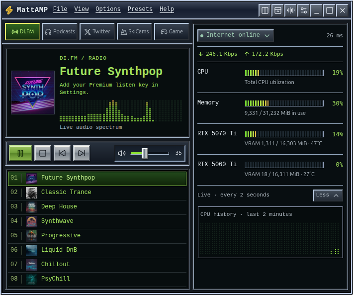

Preview from an isolated demo profile; the spectrum is driven by test audio.

</details>

**Optional nonsense:** “Send it!” for SkiCams, an action-hero “Hell yeah!” for Game, “Meh” for Podcasts/Twitter, and a long “Yeeeeah” for DI.FM. Switch **Silly sound effects** off in Settings whenever civilization requires it.

**Live backgrounds:** Particle flow, Water waves, Starfield, Mandelbrot zoom, or Off. They react gently to the mouse. Mandelbrot wanders through different regions with glides, curves, and spirals—a little Fractint affection, without turning the room into a flashlight. Animation pauses when hidden or in bug mode and respects reduced motion.

CPU, memory, and network readings update every two seconds. Download and upload rates display in Kbps (kilobits per second), including compact mode. RAM and GPU memory readouts use MiB. NVIDIA GPU readings use `nvidia-smi`; absent sensors show as unavailable. Expand network status for router/internet checks.

## The practical bits

- **Local data:** settings, playback positions, X sessions, and arcade scores stay under `~/.config/workstation-deck/`. The old internal name preserves existing installs. [Storage and privacy](docs/guide.md#local-data-and-privacy)
- **Updates:** manual. There is no auto-updater or automatic launch at login. [Update and uninstall](docs/development.md#updating-and-uninstalling)
- **Trouble:** [launch errors, radio, YouTube feeds, X login, and missing meters](docs/guide.md#troubleshooting).
- **Credits:** Winamp and Fractint supplied the nostalgia; Scorched Earth inspired the artillery. Bundled retro artwork and audio retain their original copyrights. This repo does **not** grant a blanket license to redistribute them. See [asset credits](assets/arcade/README.md) and [startup audio provenance](docs/guide.md#startup-audio-and-credits).

A fun personal app that escaped the desktop. Bring headphones. Blame the wind.
