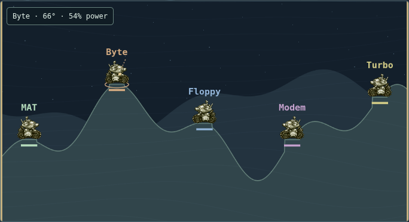
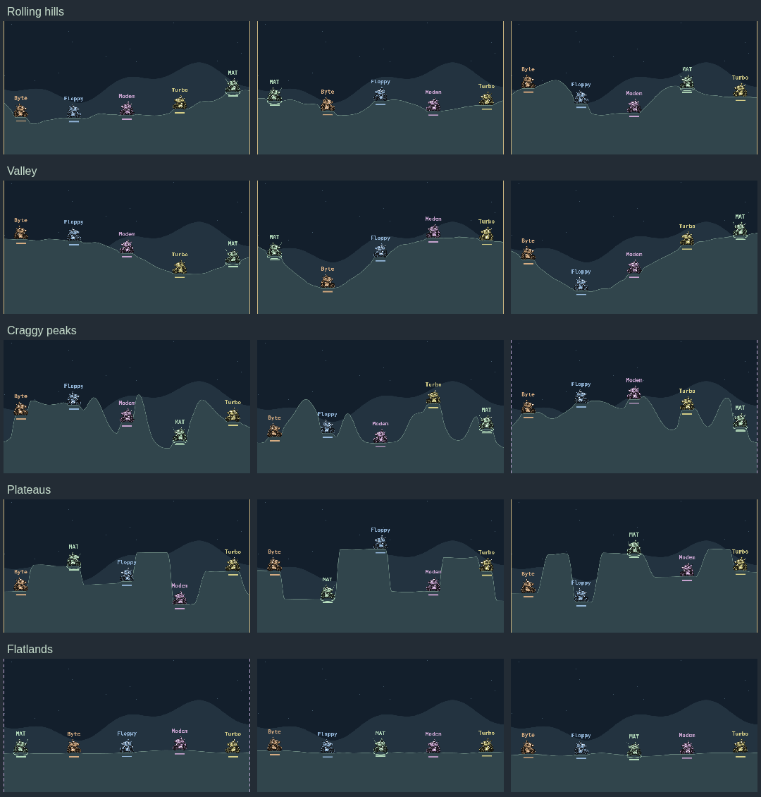

# AMP Artillery: field manual

[← Back to the README](../README.md) · [Setup and troubleshooting](guide.md)

## Pick a fight

Open **Game**. Enter up to three arcade initials, choose **3–5 bots**, select **Very dumb / Casual / Sharp / Human-ish**, and choose **Chaos**. The preview is the arena you'll get when you click the battlefield or press **Start battle**.

It's untimed, last-tank-standing artillery. Craters persist, explosions cause splash damage, and tanks can take fall damage. Damage increases after round 12 to keep a battle moving. Bot aim is imperfect; higher skill improves the opposition without making every decision deterministic.

Each tank is tinted to match its name, health bar and roster color, with the original sprite shading intact.

Each tank receives unlimited **Shells** and **three MIRVs**. A MIRV splits into five warheads at the top of its arc. Bot and player projectiles use the same physics.

## Aim and fire

| Input | Action |
| --- | --- |
| Left / Right arrow | Turn the barrel left / right |
| Up / Down arrow | Increase / decrease power |
| Enter | Fire |
| Click the sky | Aim toward that point |
| Wheel over Angle or Power, including its label | Adjust that value |
| Wheel over the battlefield | Adjust power |
| Shell / MIRV radio buttons | Select ammunition |
| Pause | Pause/resume the battle |
| Expand | Open the large, resizable game layout |
| Title-bar Maximize / Restore | Fill the screen, then return to your previous window size |
| In-game Restore / Escape | Leave expanded play; Escape dismisses an active victory ceremony first |

Game keeps the window size you choose through battle resets, results, and new skirmishes. Settings, bug mode, and hiding the app temporarily leave the battle; returning restores its size. Switching to another tab returns to the normal widget layout. **Restore** or the layout controls still let you change size explicitly.

The title-bar square beside minimize maximizes the window. In Game it uses the same viewport layout as Expand, keeps its size through resets and Settings, and restores your previous dimensions when clicked again. Leaving Game returns to the normal widget.

Narrow layouts wrap the controls as needed. Expanded mode keeps the title bar, source tabs, battlefield, and aiming controls available; scores and credits have their own scrolling area.

**Power runs from 1–100%, starting at 50%.** The lower and middle range give finer control for nearby tanks, with the old full-power speed still available for long shots. Bots use the same scale.

When a bot fires, a small readout shows its name, launch angle, and power for three seconds. It leaves your own aiming controls unchanged and clears when you leave or reset the battle. Turn it on or off in **Settings → Game → Show bot shot angle and power**. It starts enabled and remembers your choice across restarts.

Radio or audio podcasts can continue. Game **Sound on/off** is independent. Switching tabs, opening Settings, hiding the app, or entering bug mode freezes the battle. YouTube pauses when hidden.

## Wind: sometimes a suggestion, sometimes a grudge

**Chaos Off is normal mode:** wind strength and direction are rolled once and stay fixed for the whole battle, so you can adjust from your previous shot. A new skirmish rolls fresh wind. **Mixed and Unhinged** reroll wind each turn; it stays constant throughout the shot. Either direction is equally likely.

| Chance | Strength | Range |
| --- | --- | --- |
| 60% | Mild | 0–30 |
| 30% | Strong | 31–75 |
| 10% | Wild | 76–150 |

Wild gusts are highlighted in the wind readout. These are game-strength units, not mph. **Chaos Off** can still begin with strong or wild wind, but it holds steady until the battle ends.

## Chaos arenas

**Mixed** is the default; your selection is remembered. Starting preserves the shown preview, and the next skirmish rolls a new arena.

| Mode | Terrain | Gravity / sides |
| --- | --- | --- |
| Off | Rolling hills | Normal gravity, open sides |
| Mixed | One of five styles | Changed gravity **or** special side walls |
| Unhinged | One of five styles | Changed gravity **and** special side walls |

Terrains: **rolling hills, deep valley, craggy peaks, plateaus, flatlands**. Each rolls a fresh silhouette: hills vary in height and slope, valleys shift off-center with unequal shoulders, peaks change count and steepness, and plateaus vary their shelf heights and widths. Flatlands keep low relief. Tank pads blend into the surrounding ground.

Gravity: **Normal 1×**, **Moonshot 0.64×**, **Heavy 1.6×**.

Walls:

- **Open:** shots can leave the arena.
- **Ricochet:** solid amber sides reflect shells and MIRV fragments without adding energy.
- **Wraparound:** dashed lavender sides send projectiles through the opposite edge.

The ceiling stays open. Projectiles expire after 20 simulated seconds to prevent endless volleys. Terrain style, gravity, and wall rules stay fixed for a match, while wind changes every turn only in Mixed and Unhinged. Bots account for gravity and boundaries and consider indirect shots in special arenas.

## Bots remember

Within a battle, damage makes retaliation more attractive. Higher difficulties weigh it more strongly; Very dumb is more scatterbrained. Repeated hits increase the preference, but another target remains possible.

Across the **last three completed battles**, grudges fade with age. Winning at least two of those battles attracts extra attention. This applies to bots as well as you—being human isn't the reason everyone shoots at you. Rivalries save with local records; abandoned matches don't count.

Heckles acknowledge revenge, leaders, kills, embarrassing misses, and self-inflicted damage. Expect dry sarcasm, dubious geometry, and very long memories: “You’ve been promoted to terrain,” “A warning shot to another county,” and “That crater has accrued interest.”

If you're knocked out early, stay for the carnage: surviving bots keep fighting on the battlefield, with shots, explosions, and heckles intact. Aiming controls disappear while you spectate; Pause and Sound still work. The final result and replay option appear when one tank remains (or nobody survives), and the actual winner carries their reputation into the next battle.

## Leaderboard and another round

Completed matches save automatically. Once saving finishes, click the battlefield for another skirmish, or focus it with Tab and press Enter/Space. Disk failures show a retry control. Leaving an unfinished match records no result.

The local leaderboard keeps the **top ten scores across humans and bots**, with names, difficulty, bot count, result, and arena conditions. Bot names carry a BOT label and their tank color. Your lifetime wins/completed battles remain human totals. Rivalries persist too.

Every participant in a completed battle earns points by the same rules below, including damage from craters and falls. Self-damage earns no points. The survivor gets the victory bonus; draws award none. Existing human records remain eligible, and bot records begin with newly completed battles—old bot scores are not reconstructed.

Score before difficulty/bot-count multipliers:

- **10 points** per point of enemy damage.
- **250 points** per knockout.
- On a win, **1,000 points + 5 per remaining HP**.

The table mixes Chaos modes and labels the conditions; Chaos doesn't add a separate multiplier. Older records load as Off / rolling hills / normal gravity / open edges. This is a personal arcade table, not an online competitive leaderboard or anti-cheat system.

Records live in `~/.config/workstation-deck/arcade-scores.json`, using atomic writes and duplicate-save protection.

## The disproportionate victory ceremony

The surviving tank gets a three-second side-to-side shuffle, hop, and wobble—bots included. About one in three victories adds a nose-up wheelie, balanced on the rear tread before a smooth landing. It is purely visual and never changes the final score or tank position. Reduced motion skips the dance; leaving the game or starting another skirmish cancels it.

After the dance, a human victory launches nine seconds of a gold 3D tank, moving camera, lighting, 2,400 confetti pieces, and a synthesized fanfare. **Back to scores** or **Escape** skips it. Game sound off mutes the fanfare while radio continues.

Leaving the game releases the scene. Reduced motion freezes it; unavailable WebGL falls back to a static message. Score saving doesn't depend on the celebration succeeding.

## Credits

The game draws inspiration from Scorched Earth. Its retro tank/explosion sprites and effects come from Metal Slug and Worms 2, with Kenney fallback assets. Their licenses differ; the retro material is not CC0. The procedural 3D celebration uses Three.js, the bundled Cormorant Garamond font, and an original synthesized fanfare.

See [full asset credits](../assets/arcade/README.md) and the [source manifest](../assets/arcade/sources.json).
