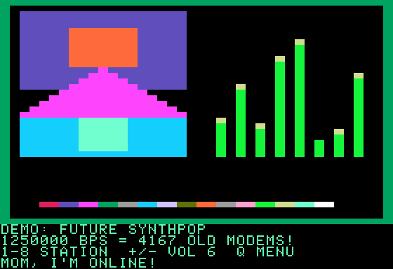
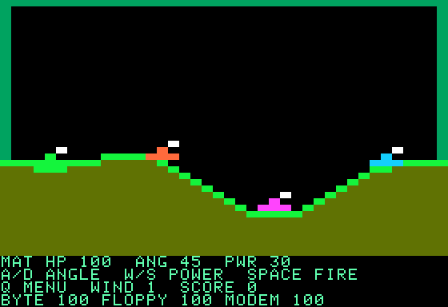

# MattAMP //e — the 300 bps edition

**Real Applesoft BASIC. Fake internet. Three tiny enemies.**

A small standalone companion to MattAMP, for the machine that made an acoustic coupler feel like the future. Written in line-numbered Applesoft BASIC, using its built-in 16-color low-resolution graphics. No JavaScript inside the program, no machine-language helpers, and no expansion card required.

This is a playable offline adaptation, not the modern Electron app or its proposed //e skin. The radio screen is a silent demo; the artillery game actually runs.

| Radio / modem demo | AMP Artillery |
| --- | --- |
|  |  |

Actual captures in Joshua Bell's JSBASIC interpreter. Its display supplies the green text; text color on a real Apple depends on your display setup. The BASIC program chooses green graphics borders itself.

## Try it in a browser

1. Download [MATTAMP.bas](MATTAMP.bas) using GitHub's **Download raw file** action, or use the file from your clone.
2. Open [Applesoft BASIC in JavaScript](https://inexorabletash.github.io/jsbasic/).
3. Click **Load**, choose `MATTAMP.bas`, then **Run**.
4. Click the simulated screen, enter up to three initials, and press Return.

The interpreter loads on the web, but the program makes no network requests. Once loaded, the demo and game run locally. The interpreter is a third-party project, not bundled with MattAMP.

## Run on an Apple II or an emulator

Use an Apple II with Applesoft in ROM and at least 48 KB of RAM, in 40-column text mode. An Apple IIe is a suitable target. This edition uses `GR`: **40 × 40 color blocks with four text lines**. It deliberately does not require double-hi-res, an Extended 80-Column card, a Super Serial card, or an Echo driver.

At a fresh Applesoft prompt, enter `NEW`, then paste/type the **entire numbered listing** from `MATTAMP.bas`. Use your emulator's slow/paced paste function if necessary. Enter `RUN` when the listing has finished loading. Control-C interrupts the program.

For physical hardware, transfer the listing using your existing disk/serial workflow. With your own DOS 3.3 disk, the listing can be imported as a carriage-return-delimited text file and loaded with `EXEC MATTAMP.TXT`, then stored as a tokenized program with `SAVE MATTAMP`. The `.bas` file here is plain text, not a disk image or an already-tokenized Apple file. No Apple ROM or DOS disk is distributed here.

**Validation:** compiled and exercised with JSBASIC, including browser rendering and keyboard input. Not yet tested on a physical IIe or a ROM-based emulator; hardware timing, paste behavior, and ROM compatibility still need that check. The source avoids JSBASIC's extensions.

## What works

- A menu, initials, and a session-best score.
- Eight familiar station names with a colorful mountain and animated demonstration spectrum. The volume number is also a simulation; no radio audio plays.
- A rotating modem monologue: “Mom, I'm online!” → Havre, Montana to Boston → a long-distance pirate BBS call → “That's not a problem… right?” → “The software is free. The phone bill is not.”
- `1250000 BPS = 4167 OLD MODEMS!` — a deliberately fictional bandwidth readout, rounded against 300 bps.
- Four-tank skirmishes: you and three bots, random rolling terrain, fixed wind per battle, ballistic shells, splash damage, craters, and a few dry remarks.
- Bots target any living rival. The battle continues after your tank dies.
- Your tank is green; Byte is orange, Floppy purple, and Modem blue. Their health is listed in the text area.
- Built-in speaker bells. Sound depends on interpreter/emulator support.

**Not ported:** streaming, podcasts, X, live cams, real workstation metrics, Echo speech, MIRVs, persistent scores, multi-game grudges, or the 3D victory ceremony. Those remain the modern app's job. Score and best score reset when you quit/restart BASIC; nothing writes to disk automatically.

## Controls

| Screen | Keys |
| --- | --- |
| Main menu | `1` radio demo, `2` artillery, `3` about, `Q` quit |
| Radio demo | `1`–`8` station, `+`/`-` simulated volume, `Q` menu |
| Artillery, your turn | `A` raises angle toward the left; `D` lowers it toward the right; `W`/`S` power; Space or Return fires; `Q` abandons to menu |
| After the battle | `N` new battlefield, `Q` menu |

Angles run from 5° (right) to 175° (left), with 90° straight up. Power runs from 2 to 100. Wind is fixed for the battle: negative pushes left, positive pushes right. You get 10 points per damage point dealt to bots, 500 per knockout, and 1,000 for winning. Session best records completed battles only.

## Source map

| Lines | Purpose |
| --- | --- |
| 10–330 | Setup, initials, menu, quit |
| 1000–1510 | Color radio demo and keyboard polling |
| 3000–4110 | Battlefield setup, turn order, controls, bot decisions |
| 4500–5250 | Flight, impact, damage, craters |
| 6000–6110 | Results, best score, replay |
| 7100–7210 | Terrain and tank rendering |
| 8000–8110 | About screen |
| 9000–9040 | Station names and modem dialogue |

## Reproduce the compatibility check

From the repository root, with Node.js and Git installed:

```sh
git clone https://github.com/inexorabletash/jsbasic.git /tmp/mattamp-jsbasic
git -C /tmp/mattamp-jsbasic checkout bff32795f65d19527b8d96f60e22734d119262dd
node extras/apple-iie/check.cjs /tmp/mattamp-jsbasic/basic.js
```

Use a fresh destination if that directory already exists. The check compiles the actual listing, drives menus and station selection, checks volume/aim/power limits, plays a complete battle, exercises spectator mode after player death and replay, and checks all plotted coordinates. It does not emulate a 6502 or replace a real-hardware test. No extra production dependency or change to the Electron release pipeline is required.

References: [Apple's Applesoft programming manual](https://mirrors.apple2.org.za/ftp.apple.asimov.net/documentation/programming/basic/Applesoft%20BASIC%20Programming%20Reference%20Manual%20%28alt%29.pdf), [JSBASIC source and limitations](https://github.com/inexorabletash/jsbasic), and its [language reference](https://www.calormen.com/jsbasic/reference.html).

Please don't pick up the phone.
